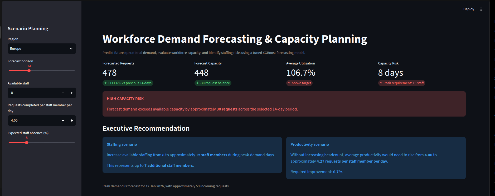
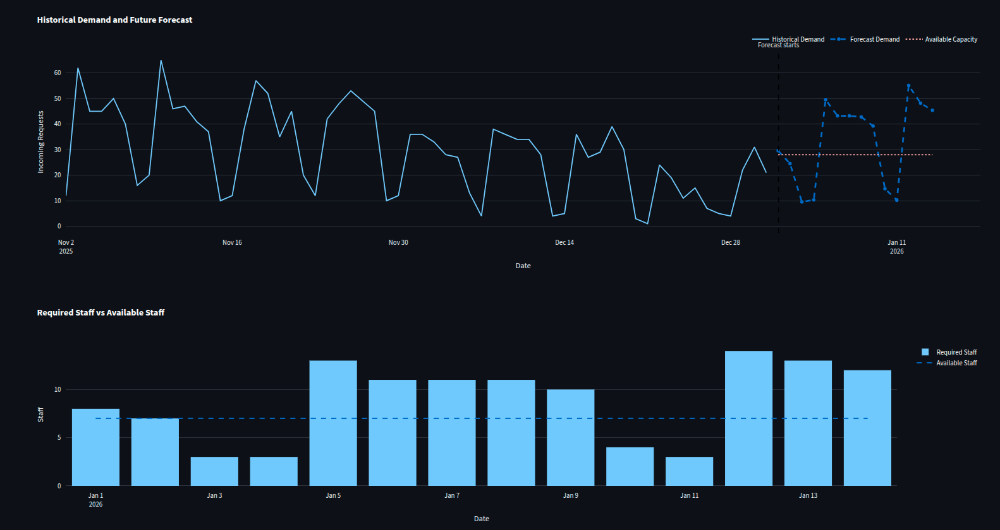
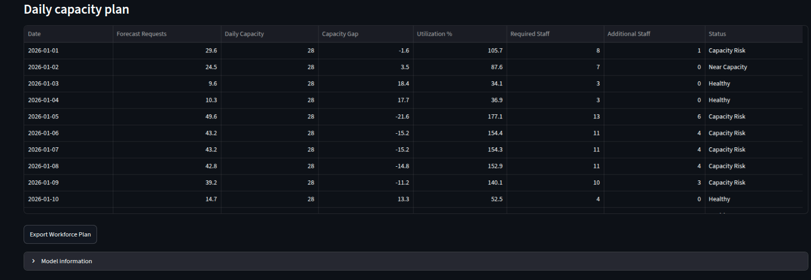

# 📈 Workforce Demand Forecasting & Capacity Planning

> An end-to-end machine learning platform for forecasting workforce demand and supporting operational capacity planning using time-series forecasting, XGBoost, Streamlit, and Docker.


---

# Overview

Organizations continuously receive workforce-related requests such as onboarding, worker extensions, data corrections, and operational support. Predicting future demand enables managers to proactively allocate staff, reduce backlog, and improve operational efficiency.

This project simulates an enterprise workforce management environment and implements a complete machine learning pipeline to forecast future request volumes and evaluate workforce capacity under different staffing scenarios.

The solution includes:

- Synthetic enterprise workforce dataset generation
- Time-series feature engineering
- Multiple forecasting models
- Hyperparameter tuning using time-aware cross-validation
- Recursive demand forecasting
- Interactive Streamlit dashboard
- Capacity planning and staffing recommendations
- Dockerized deployment

---

# Project Architecture

```
                Workforce Requests
                        │
                        ▼
          Synthetic Data Generation
                        │
                        ▼
            Feature Engineering Pipeline
        (Lag • Rolling • Calendar Features)
                        │
                        ▼
          Model Training & Validation
      ┌──────────┬─────────────┬──────────┐
      │ Baseline │ RandomForest│ XGBoost  │
      └──────────┴─────────────┴──────────┘
                        │
                Best Performing Model
                        │
                        ▼
             Future Demand Forecasting
                        │
                        ▼
          Capacity Planning Engine
                        │
                        ▼
          Streamlit Decision Dashboard
```

---

# Features

## Data Engineering

- Synthetic workforce demand generation
- Daily operational request simulation
- Multi-region support
- Calendar-based demand patterns
- Holiday and weekend effects
- Workforce availability simulation

---

## Feature Engineering

The forecasting model uses engineered time-series features including:

- Lag Features (1, 2, 7, 14 and 30 days)
- Rolling Mean (7 and 30 days)
- Rolling Standard Deviation
- Cyclical Day Encoding
- Cyclical Month Encoding
- Week of Year
- Quarter
- Staff Availability
- Staff Absence Rate
- Holiday Indicators

---

## Machine Learning Models

Models evaluated:

| Model | Purpose |
|---------|----------|
| Naive Lag Baseline | Benchmark |
| Linear Regression | Linear baseline |
| Random Forest | Ensemble model |
| XGBoost | Final production model |

---

# Model Performance

| Model | MAE | RMSE |
|--------|------:|------:|
| Naive Baseline | 8.95 | 12.81 |
| Linear Regression | 7.26 | 10.16 |
| Random Forest | 5.95 | 9.01 |
| **Tuned XGBoost** | **5.78** | **8.82** |

Final Production Model

- MAE: **5.78**
- RMSE: **8.82**
- WAPE: **15.84%**
- Time-aware Cross Validation
- Recursive Multi-step Forecasting

---

# Dashboard

The application provides an interactive decision-support interface for workforce planning.

## Executive Dashboard

The landing page summarizes forecasted demand, available capacity, utilization, capacity risk, and automatically generates staffing recommendations.



---

## Historical Demand & Forecast

Visual comparison of historical operational demand, predicted future demand, and available workforce capacity.



---

## Capacity Planning Table

Daily operational planning including predicted requests, workforce utilization, required staffing, and capacity status.



# Folder Structure

```
workforce-demand-capacity-planning/

│
├── app/
│   └── app.py
│
├── data/
│   ├── raw/
│   └── processed/
│
├── models/
│
├── reports/
│
├── src/
│   ├── generate_data.py
│   ├── features.py
│   ├── train.py
│   ├── tune_xgboost.py
│   ├── evaluate.py
│   └── forecast.py
│
├── Dockerfile
├── docker-compose.yml
├── requirements.txt
├── README.md
└── LICENSE
```

---

# Installation

Clone the repository

```bash
git clone https://github.com/<your-username>/workforce-demand-capacity-planning.git

cd workforce-demand-capacity-planning
```

Create a virtual environment

```bash
python -m venv .venv
```

Activate

Linux / macOS

```bash
source .venv/bin/activate
```

Windows

```bash
.venv\Scripts\activate
```

Install dependencies

```bash
pip install -r requirements.txt
```

---

# Running the Project

## Generate Synthetic Data

```bash
python src/generate_data.py
```

---

## Create Time-Series Features

```bash
python src/features.py
```

---

## Train Models

```bash
python src/train.py
```

---

## Hyperparameter Tuning

```bash
python src/tune_xgboost.py
```

---

## Model Evaluation

```bash
python src/evaluate.py
```

---

## Generate Future Forecast

```bash
python src/forecast.py
```

---

## Launch Dashboard

```bash
streamlit run app/app.py
```

---

# Docker

Build

```bash
docker build -t workforce-capacity-planner .
```

Run

```bash
docker run -p 8501:8501 workforce-capacity-planner
```

---

# Business Use Cases

The project demonstrates how machine learning can support operational decision-making by:

- Forecasting future workforce demand
- Identifying staffing shortages
- Estimating workforce capacity
- Supporting workforce planning
- Reducing operational backlog
- Improving resource allocation

---

# Future Improvements

Potential extensions include:

- SHAP model explainability
- Automated model retraining
- Cloud deployment
- Real enterprise workforce data
- API integration
- Live scheduling optimisation

---

# Technologies

- Python
- Pandas
- NumPy
- Scikit-learn
- XGBoost
- Streamlit
- Plotly
- Docker

---

# Author

**Vaibhav Gupta**

Data Analyst | Aspiring Data Scientist

---

# License

This project is licensed under the MIT License.